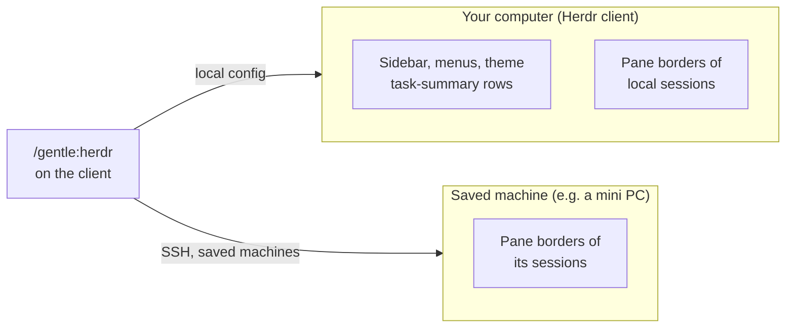

<a id="top"></a>

<p align="center">
  
</p>

<h1 align="center">gentle-herdr</h1>

<p align="center"><strong>Make Herdr look like your Gentle Shell, on every machine you use.</strong></p>

<p align="center"><strong><a href="#quick-start">Quick start</a> &nbsp;·&nbsp; <a href="#the-menu">Menu</a> &nbsp;·&nbsp; <a href="#saved-machines">Saved machines</a> &nbsp;·&nbsp; <a href="#safety">Safety</a></strong></p>

`gentle-herdr` is an extension for [Gentle Shell](https://github.com/Gentleman-Programming/gentle-shell) users who work inside [Herdr](https://herdr.dev). One command, `/gentle:herdr`, sets Herdr's theme, styles the task-summary rows in the sidebar, and colors the pane borders of each machine you connect to. You never hand-edit `config.toml`.

```sh
gentle-shell install git:github.com/MarsSall/gentle-herdr@v0.1.0
```

<a id="stack"></a>

## Stack

<div align="center">
<a href="https://github.com/Gentleman-Programming/gentle-ai">
  
</a>
</div>

<div align="center">


</div>

## Highlights

| | |
|---|---|
| 🎨 **Follows your Gentle Shell theme** | The **Default** theme takes its colors from your active Gentle Shell theme and updates when you switch themes. |
| 👀 **Live preview** | See a mock Herdr sidebar with the real colors while you move through the list, before anything is saved. |
| 🖥️ **Per-machine pane borders** | Give each saved Herdr machine its own theme, so you can tell at a glance which machine a pane runs on. |
| 🛡️ **Safe config edits** | Only the package's own stamped blocks change. Your comments, layout and custom colors stay untouched, and anything ambiguous is refused, not guessed. |
| 🪟 **Linux and Windows** | Works with local Herdr on Linux and Windows. Saved machines can be Linux, macOS or BSD. |

## Quick start

1. **Install** the extension (above) and restart Gentle Shell, or run `/reload`.
2. In a Gentle Shell session **inside Herdr**, run `/gentle:herdr`.
3. Pick a **Theme**. Move with ↑/↓ to preview, and press Enter to confirm.
4. Herdr reloads its config, and the new colors show up right away.

Optional: open **Machines** to give a saved machine its own pane-border theme.

## The menu

| Entry | What it does |
|---|---|
| **Theme** | **Default** follows your active Gentle Shell theme, and the menu names it, for example *Default (follows your Gentle Shell theme: Gentleman-Cute)*. You can also pick any built-in Herdr theme (catppuccin, tokyo-night, dracula, nord, gruvbox, one-dark, solarized, kanagawa, rose-pine, vesper, terminal). |
| **Summary color** | Color of the two task-summary rows in the sidebar: Default (your accent, dimmed), accent, text, muted, dim, success, warning or error. |
| **Machines** | A theme for each enabled saved Herdr machine: **Same as this computer**, **Default** or a built-in theme. |
| **Apply now** | Apply your saved choices again, here first and then on every saved machine. |
| **Remove from Herdr config** | Remove only what this package added. |

Highlighting never saves anything. **Enter** asks for confirmation, and **Esc** cancels.

## Who draws what

Herdr splits the rendering between the computer you sit at (the **client**) and the machine where each session runs. `gentle-herdr` writes the right config on each side.



- **The sidebar is always drawn by the client**, so it looks the same for every session.
- **Pane borders are drawn by the machine where the session runs**, which is why each machine can have its own colors.
- Run `/gentle:herdr` **on the client**. In a remote session the menu explains this and applies nothing.

## Gentle Shell themes

With **Default**, Herdr uses the `one-dark` base plus your live Gentle Shell colors, and the Gentleman.Dots profile values the palette doesn't define:

| Gentle Shell theme | In Herdr |
|---|---|
| **Gentleman-Cute** | Black panel, soft pink surfaces and text. |
| **Gentleman-Sexy** | Same surfaces as Cute, plus **fuchsia session names**, **grayish pink branches** and a **wine active row**. |
| **Gentle** | Its own dark panel color. |
| Any other theme | Live text colors over `one-dark`. |

Status and notification colors (working, done and so on) keep Herdr's own colors.

## Saved machines

To configure another machine's pane borders from your client:

1. Add it to Herdr as a **saved machine**, so it appears in `herdr machine list`.
2. Make sure you can log in with an **SSH key and a trusted host key**:
   ```sh
   ssh -o BatchMode=yes <target> true
   ```
3. In `/gentle:herdr` → **Machines**, pick the machine and its theme, then confirm.

You get one result per machine: `applied`, `unchanged`, `conflict`, `auth`, `unreachable`, `unsupported`, `invalid-config` or `reload-failed`. One failure never stops the other machines or undoes your local change.

> [!NOTE]
> Saved machines must run Linux, macOS or BSD. Remote Windows servers are refused. SSH never prompts for a password or a host key.

## Safety

| Guarantee | How |
|---|---|
| Your settings survive | Only hash-stamped, package-owned blocks, `theme.name` and the `$summary` styles change. Comments, ordering and line endings are preserved. |
| Your colors win | Colors you set in `[theme.custom]` are never rewritten. |
| No guessing | Ambiguous or unsupported TOML is refused without writing. |
| No lost edits on remote machines | If the remote config changed since it was read, or anything appeared in its place, the write stops with **conflict**, and your original is kept as a named backup. |
| Nothing leaks | Config content travels only over SSH stdin. Notices never include file contents or raw SSH errors. |
| Atomic writes | Local files are replaced atomically. On Windows a fixed PowerShell helper uses `File.Replace` with recovery. |

<details>
<summary><strong>Technical details and limitations</strong></summary>

**Preferences** live in `gentle-herdr.json` inside Pi's agent directory (`getAgentDir()`). The store uses schema v2 and still reads v1. Reads and writes are bounded to 4 KiB, and malformed files are refused, not overwritten.

**Config paths.** Locally, `HERDR_CONFIG_PATH` if set, otherwise `$XDG_CONFIG_HOME/herdr/config.toml` or `~/.config/herdr/config.toml` on Linux, and `%APPDATA%\herdr\config.toml` on Windows. The local config must already exist. On a remote machine, `$HERDR_CONFIG_PATH` or `${XDG_CONFIG_HOME:-$HOME/.config}/herdr/config.toml`. A missing remote config is created with mode 0600.

**Remote write protocol.** The current config is moved aside to a private sibling and its SHA-256 is checked against what was read. The new file is committed with a no-overwrite hard link, verified by regular-file type and device/inode. A mismatch, or a file, directory or link that appeared in the meantime, is a conflict: the external entry stays untouched and the original remains as `config.toml.gentle-herdr.backup.<nonce>`. Only the backup's basename is reported. `herdr --machine <label> server reload-config` runs only after a verified commit. Remote requirements: `sh`, `sha256sum`, `head -c`, `mktemp`, hard links, and GNU or BSD `stat`. Config content is limited to 256 KiB.

**Automatic re-apply.** While Theme is **Default**, a lightweight watcher checks the active Gentle Shell theme every 500 ms and re-applies once per change, to this computer and to saved machines whose theme is Default. It produces at most one notice per change. It never runs in child sessions.

**Limitations.**
- There is no transaction across machines.
- On a remote machine, the config path is briefly absent while the file is swapped.
- An editor that keeps the old file open and writes in place right after the hash check can lose those bytes. Avoid editing the remote config at the same time as you apply.
- SIGKILL, a host failure or a lost SSH acknowledgement can leave staging, lock or backup files that need manual cleanup. HUP, INT and TERM clean up and exit with 128+signal.
- **Remove from Herdr config** only affects this computer.
- Previews of built-in Herdr themes show their name only, because Herdr does not expose their palettes.
- "Reload requested" confirms the reload, not what the client rendered.

</details>

## Remove and uninstall

1. `/gentle:herdr` → **Remove from Herdr config**. This removes only the package's own blocks. Edited or ambiguous blocks are refused rather than guessed.
2. Uninstall the extension:
   ```sh
   gentle-shell remove git:github.com/MarsSall/gentle-herdr
   ```

Uninstalling alone does not undo config edits, so run step 1 first. Your preferences file is kept.

## Relationship to Gentle Shell

Gentle Shell owns the task-summary **text and its on/off switch** (`/gentle:customize` → **Layout**) and publishes the agent status. This package only **styles** Herdr: it never publishes activity and never changes Gentle Shell's settings. It doesn't need any change to Gentle Shell either.

## Development

```sh
npm install
npm test          # node --test with type stripping; never touches your real Herdr config
npm run typecheck
```

Requires Node.js 22+. The Windows/NTFS replacement tests only run on Windows.

## License

[MIT](LICENSE). Based on the author's original Herdr visuals contribution to Gentle Shell ([#2392](https://github.com/Gentleman-Programming/gentle-shell/issues/2392)).
